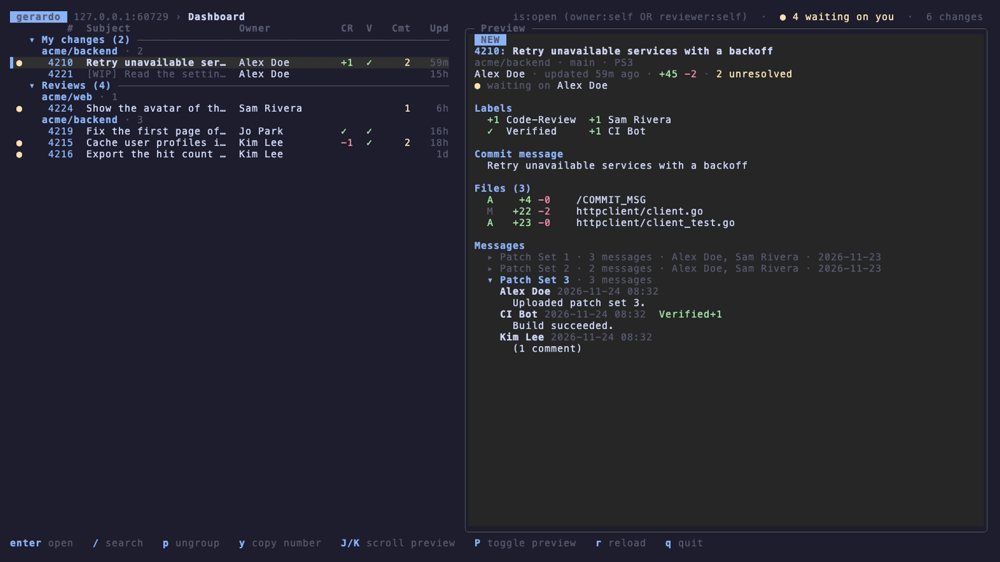

# gerardo

A terminal client for reviewing [Gerrit](https://www.gerritcodereview.com/) changes: dashboard with preview, diffs (unified or side by side) between any two patch sets, inline comments, votes, submit and rebase.



Try it without a server: `gerardo -demo`.

## Install

Download a binary from the [releases](https://github.com/peano88/gerardo/releases), or:

```sh
go install github.com/peano88/gerardo@latest   # Go 1.26.8+
nix run github:peano88/gerardo                 # the flake also has an overlay
```

## Configure

`~/.config/gerardo/config.toml` (flags and `GERRIT_URL` override it):

```toml
url = "https://review.example.com"
query = "is:open (owner:self OR reviewer:self)"
side_by_side = true
hidden_paths = ["legacy/*"]   # hide changes touching only these
```

Credentials come from `~/.netrc` (`machine review.example.com login <user> password <http-password>`, the HTTP password from Gerrit's settings) or `GERRIT_USER` / `GERRIT_PASSWORD`.

## Use

Each screen lists its keys at the bottom; `?` shows them all in a diff.
